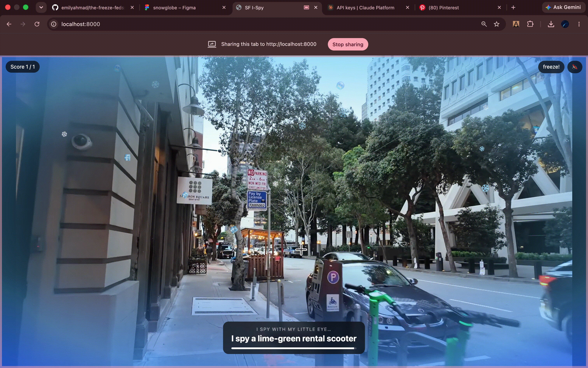
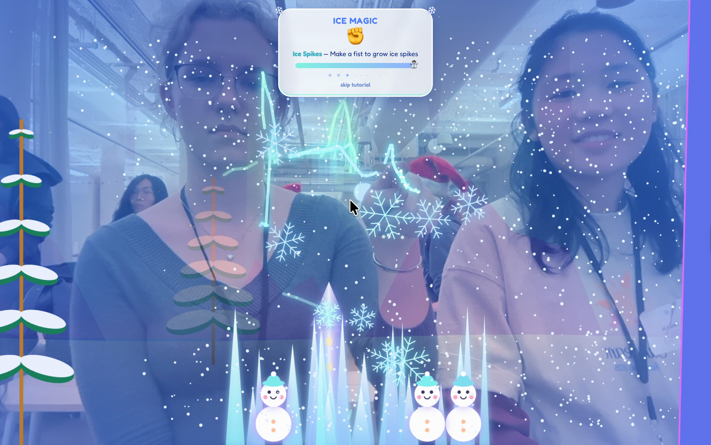
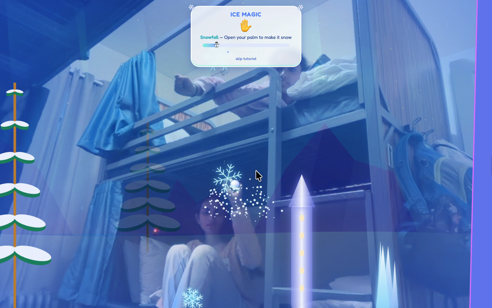
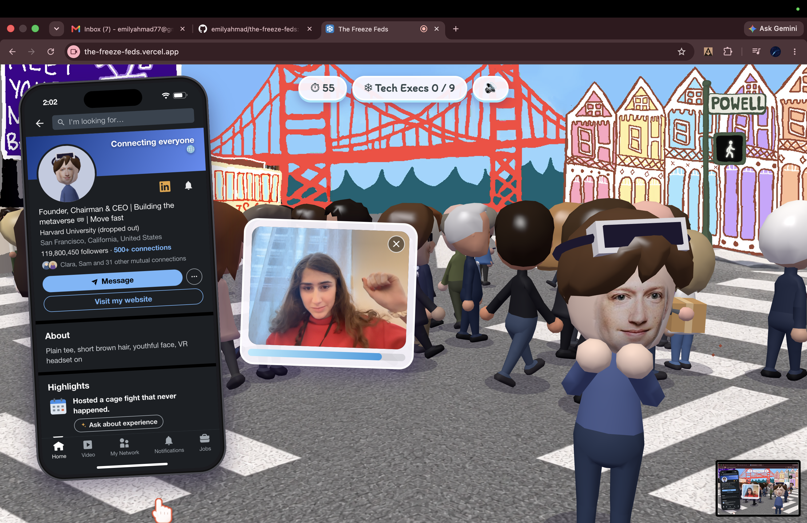

# The Freeze Feds

Everyone keeps complaining that it's AI slop, so I'm making another version without any AI, I'm currently building it in the no-ai branch, once it's done I'll push to main

## Live Demo: https://the-freeze-feds.vercel.app/

## How to play
1. Click on suspicious people walking around to inspect their LinkedIn profiles
2. If you wanna freeze them, click the freeze button and give camera access to the web app to throw a snowball at the CEO (make a fist and release it by "throwing" it at the camera)
3. If innocent you can let them go and continue your perusal
4. If you hit a tech exec you get 10+ seconds added to the clock, if you hit an innocent, then you'll lose 10 seconds on the clock
5. Try to freeze them all before time runs out!

## How to run it yourself
1. install npm
   npm install
2. run locally
   npm run dev
3. click on the local host link and you're done !

## Tools
Built with Blender, JS, CSS, and HTML

## Team!
Emily Ahmad, Adishree Das, Haya Raham Asif

## How we built it
When we started the hackathon, we had two big ideas:

When we first landed in SF, one of the biggest things we were looking forward to was seeing all the AI billboards. On the way to the hostel, we spotted about 10. This inspired our first idea:
+ an eye-spy game where you are traversing the streets of downtown SF (either through Google streetview or embedding a Youtube video). Every 5-8 seconds, they'd have to FREEZE and find something within the video frame -- an AI billboard, an undercover tech executive, a cable car; something SF-coded
+ our second idea was a "be elsa" simulator, a pose/gesture detection computer vision project where you can use different poses to generate snow figures on the screen, some abilities include: tracing with ice, generating blizzards by waving both palms towards the camera slowly, erecting icicles and snowmen by pumping your fists up, throwing snowballs at the screen, and much more.

  
  
  

We left Notion and dilly daddled for quite a bit, then it hit 10 PM and we were all sitting in our hostel beds and we realized we have to narrow down on an idea and figure out what we're actually going to build over the next two days.

We started throwing ideas around but we knew we wanted to keep certain elements from our original ideas, including throwing snowballs with pose detection, exploring the streets of SF, spotting tech execs

We finally narrowed down on an idea

Once we got the theme: "Freeze"

A take on Find Mii but you're the freeze police and you're freezing tech execs in the streets of SF.

<!-- Hardware idea: -->

  

<!--
navigate the screen using macropad:
macropad functions:
* starts by selecting Mii on the very left (stays selected), then users can you use SW1 (left) and SW2 (right) to select Miis. If they want to inspect a Mii (view their linkedIn), they can press SW3 and the mii will come forward. Once they are inspecting the Mii, they can press Sw3 again to relesae then, or Sw4 to trigger the snowball throwing, and then the game continues.

It would be cool if you could plug in the macropad to any device, and it would open up the game in a browser, then start playing

Also for a complete hardware implementation/or issues with the web camera on the device, we can connect the xiao esp32-s3 sense as the camera

and somehow use the TFT - maybe to show the linkedin profile?
it would start off by saying no Mii selected, then when you want to inspect one it would show up

### Setting up the macropad

The pad is the s'mores-pad (Seeed XIAO ESP32-C3 with a 128x32 OLED). Just like in the original [smores-pad](https://github.com/emilyahmad/smores-pad) firmware, it pairs as a **Bluetooth keyboard** called "Macropad", so it works in any browser and needs no cable once it's charged or powered.

1. **Flash it** (Arduino IDE, same setup as the smores-pad): open `hardware/freeze-pad/freeze-pad.ino`, board **XIAO_ESP32C3**, with the ESP32-BLE-Keyboard and Adafruit SSD1306/GFX libraries installed. Then upload.
2. **Pair it:** the OLED says "Pairing…". On the Mac, go to System Settings → Bluetooth and connect "Macropad". If it was already paired with the old firmware, it usually reconnects by itself. If it doesn't, choose "Forget This Device" and pair again. When it's connected, the OLED says "Freeze Feds / ready to freeze".
3. **Play:** run `npm run dev` and open the game. Click the game window once so it has keyboard focus.

| Key | Types | Street | Checking someone |
|---|---|---|---|
| SW1 | ← | select the next person to the left | – |
| SW2 | → | select the next person to the right | – |
| SW3 | Enter | call the selected person up (ID check) | let them go |
| SW4 | Space | – | Freeze: opens the snowball cam (press again to throw without the gesture) |

On the title and end screens, SW3 (Enter) presses the button. A normal keyboard's arrows, Enter and Space do the same. Moving the mouse switches back to mouse control.
-->
